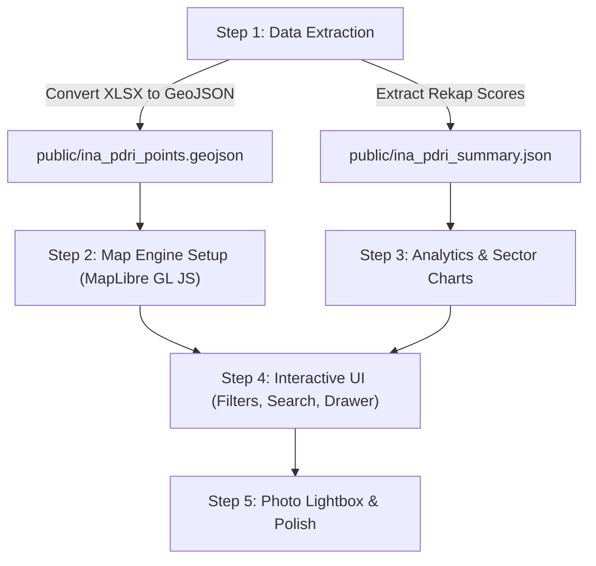

# Ina PDRI (Indonesia Post-Disaster Recovery Index) - GIS Web Platform
## Project Specification & Architecture Plan

---

## 1. Executive Summary

**Ina PDRI (*Indeks Pemulihan Pascabencana Indonesia*)** is a comprehensive multi-sector assessment framework developed to measure and monitor post-disaster recovery progression across Indonesian disaster-affected areas.

This project transforms the field survey data in `data/Ina PDRI 2026.xlsx` into an interactive, high-performance GIS Web Dashboard built with **Next.js 16**, **React 19**, and **Tailwind CSS**. The platform enables stakeholders, government agencies, and the public to:
1. Visualize **762 geo-tagged survey points** across **17 provinces** and **42 regencies/cities (Kabupaten/Kota)**.
2. Filter and analyze spatial distribution by disaster type (Flood, Landslide, Earthquake, Liquefaction, Drought, Tsunami).
3. Inspect multi-temporal recovery indicators across 5 core sectors from **T-1 (pre-disaster baseline)** up to **T+4 (four years post-disaster)**.
4. Explore field survey evidence, including on-site water quality photos and surveyor validations.

---

## 2. Dataset Analysis (`data/Ina PDRI 2026.xlsx`)

The dataset contains **55 worksheets**, organized into raw survey responses, processed summaries, and administrative/sector breakdowns:

### 2.1 Sheet Categories
| Sheet Category | Sheet Names | Description |
| :--- | :--- | :--- |
| **Primary Survey Data** | `Survey Ina PDRI Tahun 2026`, `Data Olah` | 762 geo-referenced individual survey responses with over 300 indicator columns. |
| **Overall Summary** | `Rekap Total Data` | Master directory mapping each province and kabupaten/kota to response counts. |
| **Provincial Rekap** | `Rekap Aceh`, `Rekap Sumatera Utara`, `Rekap Jambi`, `Rekap Sumatera Selatan`, `Rekap Bengkulu`, `Rekap Jawa Barat`, `Rekap Jawa Tengah`, `Rekap Jawa Timur`, `Rekap NTB`, `Rekap Sulawesi Tengah` | Sector-by-sector index comparison across years ($T_{-1}$ to $T_{+4}$) with recovery status classifications (*Belum Pulih*, *Menuju Pulih*, *Pulih*). |
| **Kabupaten Sheets (42)** | `Aceh Jaya`, `Aceh Barat`, `Nias Utara`, `Kota Bitung`, etc. | Disaggregated respondent records and indicator scores per municipality. |

### 2.2 Spatial & Geographic Metrics
- **Total Survey Points**: 762 geo-tagged locations with valid coordinates (100% of surveyed entries).
- **Geographic Extent**:
  - **Latitude**: `-8.5358°` to `5.1344°` (Covers southern Java/Nusa Tenggara to northern Aceh).
  - **Longitude**: `95.3378°` to `136.2539°` (Spans from Aceh in western Indonesia to Papua in the east).
  - **Altitude Range**: `-205.7 m` to `1562.3 m` (Coastal plains to high mountainous disaster zones).
  - **Accuracy / Precision**: Available per survey point ($1.5\text{ m} - 15\text{ m}$).
- **Administrative Hierarchy**:
  - **Provinces (17)**: Sulawesi Selatan (137), Sumatera Selatan (108), Jawa Timur (78), Jawa Barat (70), Sulawesi Tengah (60), Sumatera Utara (45), Aceh (44), Sulawesi Tenggara (40), Maluku (27), Nusa Tenggara Barat (24), Sulawesi Utara (20), Bengkulu (20), Maluku Utara (20), Jawa Tengah (20), Papua (20), Kalimantan Selatan (19), Jambi (10).
  - **Regencies / Cities**: 42 Kabupaten / Kota.
  - **Sub-districts (Kecamatan) & Villages (Desa/Kelurahan)**: Granular administrative address records for each survey coordinate.

### 2.3 Disaster Types & Distribution
| Disaster Type | Count | Percentage | Primary Regions |
| :--- | :---: | :---: | :--- |
| **Banjir (Flood)** | 435 | 57.1% | Sumsel, Sulsel, Jabar, Jatim, Aceh |
| **Tanah Longsor (Landslide)** | 133 | 17.5% | Sulsel (Luwu, Toraja), Jabar, Jateng |
| **Gempa Bumi (Earthquake)** | 35 | 4.6% | Sulteng (Palu/Sigi), Jabar (Cianjur) |
| **Compound Disasters** (Banjir + Longsor / Gempa + Banjir) | 62 | 8.1% | Sulawesi, Sumatera, Jawa |
| **Kekeringan (Drought)** | 22 | 2.9% | Jawa Timur, Nusa Tenggara Barat |
| **Likuefaksi & Tsunami** | 2 | 0.3% | Sulawesi Tengah |

### 2.4 Multi-Sector Evaluated Indicators
Each survey point records condition changes over time across five foundational sectors:
1. **Pemukiman (Housing & Settlement)**: Building damage, house ownership, floor area, wall/roof materials, habitability.
2. **Infrastruktur (Infrastructure)**: Road accessibility, clean water supply, electricity network, sanitation facilities.
3. **Sosial (Social Sector)**: Access to health facilities, school continuity, village governance service satisfaction, neighborhood social cohesion & security.
4. **Ekonomi (Economic Livelihood)**: Informal vs. formal employment days, household annual income, government aid receipt, banking & financial access.
5. **Lintas Sektor / Lingkungan (Environment & Cross-Sector)**: River/lake/forest utilization income, water quality assessments, and on-site photographic evidence (**544 photo URLs**).

---

## 3. Web Mapping Architecture & User Experience

### 3.1 Layout Concept: GIS Workspace & Analytics Split-View
We propose a **modern split-screen GIS application** inspired by modern spatial intelligence tools (Mapbox, ArcGIS Experience Builder, Kepler.gl):

```
+----------------------------------+------------------------------------------------+
|  [Header] Ina PDRI 2026 GIS Dashboard   |  Stats: 762 Points | 17 Prov | 42 Kab    |
+----------------------------------+------------------------------------------------+
|  [Sidebar & Filter Panel]        |  [Interactive Map Area]                        |
|                                  |                                                |
|  * Search: Desa/Kecamatan/Kab    |  - Vector Basemap (Voyager / Dark / Satellite)  |
|  * Filter by Provinsi (17)       |  - Supercluster / Dynamic Marker Clustering    |
|  * Filter by Kab/Kota (42)       |  - Color-coded pins by Disaster Type           |
|  * Filter by Disaster Type       |  - Click Marker -> Slide-over Detail Drawer    |
|  * Basemap Style Switcher        |                                                |
|                                  |                                                |
|  [Provincial Recovery Summary]   |  [Map Floating Controls]                       |
|  * Sector index summary card     |  - Navigation & Zoom Controls                  |
|  * Status badge (Pulih/Belum)    |  - Metric Scale Indicator                      |
|  * Open Rekap Modal button       |  - Quick Disaster Legend                       |
+----------------------------------+------------------------------------------------+
```

### 3.2 Key Map Features
1. **Marker Clustering & Dynamic Zoom**:
   - At country zoom level (zoom 4–6), markers aggregate into province/regional clusters displaying point counts.
   - Zooming into regencies (zoom 9–13) expands clusters into distinct survey markers with disaster-specific iconography.
2. **Intelligent Color Coding**:
   - **By Disaster Type**:
     - 🔵 Flood (*Banjir*) = `#2563EB`
     - 🟠 Landslide (*Tanah Longsor*) = `#D97706`
     - 🔴 Earthquake (*Gempa Bumi*) = `#DC2626`
     - 🟣 Liquefaction / Tsunami = `#7C3AED`
     - 🟡 Drought (*Kekeringan*) = `#CA8A04`
3. **Altitude & Topography Metric**:
   - Display altitude metric (e.g., `85m dpl` or `1,250m dpl`) on point hover tooltip and detail drawer badges.
   - Kept focused within point inspection (removed from sidebar filter to simplify navigation).
4. **Slide-over Detail Drawer (Inspection Panel)**:
   When a user clicks a point on the map:
   - Full location trail: *Provinsi > Kab/Kota > Kecamatan > Desa > Alamat*.
   - Coordinates: Latitude and Longitude with one-click copy button (Google Maps redirect button excluded for clean in-app workflow).
   - Disaster profile: Type, Year ($T_0$), Surveyor name & survey date.
   - Elevation badge ($m\text{ dpl}$).
   - **Photo Evidence**: Compact action link button to open the full-resolution survey water quality photo directly (no inline image preview to optimize drawer performance).

---

## 4. Technical Stack & Implementation Architecture

### 4.1 Technologies
- **Framework**: [Next.js 16](https://nextjs.org/) (App Router, Server Components + Client interactivity).
- **UI Library**: [React 19](https://react.dev/) + TypeScript.
- **Styling**: [Tailwind CSS v4](https://tailwindcss.com/) with Lucide Icons.
- **Map Engine**:
  - Option A (Recommended): **MapLibre GL JS** (`maplibre-gl`) — ultra-fast WebGL vector rendering, GPU acceleration, native clustering, smooth zoom/pitch/bearing rotation, zero API key required (using OpenStreetMap / CARTO / Stadia vector tiles).
  - Option B: **Leaflet** with standard raster tiles (`leaflet` + `react-leaflet` dynamically loaded).
- **Data Visualizations**: Recharts or Chart.js for sector radar charts and recovery time-series graphs.

### 4.2 Data Pipeline (Excel to GeoJSON)
To ensure sub-millisecond load times and zero runtime Excel-parsing overhead:
1. **Offline / Build Preprocessing**:
   - Create a TypeScript/Python extraction script: `scripts/process-excel.ts` or `scripts/extract_data.py`.
   - Read `data/Ina PDRI 2026.xlsx`.
   - Output clean, structured JSON artifacts:
     - `public/data/ina_pdri_points.geojson` (Standard RFC 7946 GeoJSON FeatureCollection for direct map consumption).
     - `public/data/ina_pdri_rekap.json` (Provincial & sector aggregated time series).
     - `public/data/ina_pdri_filter_options.json` (Precomputed lists of provinces, regencies, disaster types, year bounds).
2. **Data Model (TypeScript Interface)**:
   ```typescript
   export interface InaPdriFeatureProperties {
     id: number;
     provinsi: string;
     kabupaten: string;
     kecamatan: string;
     desa: string;
     alamat: string;
     latitude: number;
     longitude: number;
     altitude: number;
     precision: number;
     tahunBencana: number;
     jenisBencana: string;
     tanggalSurvey: string;
     petugas: string;
     fotoKualitasAirUrl?: string;
     tandaTanganUrl?: string;
     // Sector indicators summary
     skorPemukiman?: number;
     skorInfrastruktur?: number;
     skorSosial?: number;
     skorEkonomi?: number;
     skorLingkungan?: number;
     statusPemulihan?: 'Pulih' | 'Menuju Pulih' | 'Belum Pulih' | 'Belum Ada Data';
   }

   export interface InaPdriGeoJSON {
     type: 'FeatureCollection';
     features: Array<{
       type: 'Feature';
       geometry: {
         type: 'Point';
         coordinates: [number, number, number]; // [lng, lat, alt]
       };
       properties: InaPdriFeatureProperties;
     }>;
   }
   ```

---

## 5. Development Roadmap & Implementation Plan



### Phase 1: Data Extraction & GeoJSON Generation
- [x] Analyze `Ina PDRI 2026.xlsx` sheets, columns, and data hygiene.
- [x] Implement Python extraction script (`scripts/extract_data.py`) to generate:
  - `public/ina_pdri_points.geojson` (762 valid survey coordinates)
  - `public/ina_pdri_summary.json` (10 provincial multi-sector rekap tables)
  - `public/ina_pdri_meta.json` (metadata bounds, disaster counts, colors)
- [x] Validate geographic bounds, altitude ranges, and photo URLs.

### Phase 2: Core Map Component
- [x] Set up MapLibre GL JS in Next.js App Router using dynamic import (`ssr: false`).
- [x] Implement native WebGL map clustering (`cluster: true`, `clusterRadius: 45`).
- [x] Replace CARTO (requires API key) with **Esri ArcGIS Online** raster basemaps (no key needed).
- [x] Implement pin styling and cluster circles with disaster color-coding.
- [x] Fix `Worker failed to load` error via `setWorkerUrl()` + serving worker files from `public/`.

### Phase 3: Filter System & Search
- [x] Build hierarchical cascading selector: *Provinsi -> Kabupaten/Kota*.
- [x] Build disaster type multi-select badges with point counts.
- [x] Build real-time search bar for Kecamatan / Desa / Petugas.
- [x] Streamline sidebar UI by removing elevation slider (altitude data retained within point detail inspection).
- [x] Fix point visibility: use `map.fitBounds()` with high `maxZoom` to auto-uncluster on filter.

### Phase 4: Detail Slide-Over Drawer & Multimedia
- [x] Add click event on map pins to open detail drawer.
- [x] Display full location context, coordinates ($lat, lng$ with one-click copy), and survey officer metadata.
- [x] Streamlined coordinates card without external Google Maps redirect button.
- [x] Compact field survey water quality photo link button (removed inline image preview for fast loading).

### Phase 5: Provincial Summary & Multi-Sector Analytics
- [x] Connect `Rekap <Provinsi>` data to an interactive analytics modal (`RekapModal.tsx`).
- [x] Compare multi-sector scores across T-1, T0, T+1, T+2, T+3, T+4 for Pemukiman, Infrastruktur, Sosial, Ekonomi, and Lintas Sektor.

---

## 6. Implementation Notes & Issues Resolved

### 6.1 Map Library Decision: MapLibre GL JS
After evaluating Leaflet and MapLibre GL JS, **MapLibre GL JS v6** was chosen for:
- **Zero API key**: WebGL vector/raster rendering with free public tile sources.
- **Native clustering**: Built-in GeoJSON `cluster: true` at source level — no plugin needed.
- **GPU acceleration**: Smooth zoom/pitch/bearing animations via WebGL.
- **Live filter updates**: `source.setData(newGeoJSON)` instantly re-renders without remounting.

### 6.2 Basemap Strategy — No API Key Required
Initially CARTO vector tile URLs (`https://basemaps.cartocdn.com/…`) returned:
> `API KEY REQUIRED — carto.com/basemaps/apikey`

Replaced with **Esri ArcGIS Online raster tiles** (public, unauthenticated):

| Style | Esri REST Endpoint |
| :--- | :--- |
| **Voyager / Light** | `World_Street_Map/MapServer/tile/{z}/{y}/{x}` |
| **Dark** | `Canvas/World_Dark_Gray_Base` + `World_Dark_Gray_Reference` overlay |
| **Satellite** | `World_Imagery/MapServer/tile/{z}/{y}/{x}` |

### 6.3 Worker URL Fix — `Worker failed to load`
MapLibre GL JS v5+ offloads tile decoding to a Web Worker. Next.js webpack resolves the worker chunk as a relative path, which fails in production. Fix applied at the **module scope** of `MapLibreView.tsx` (before any `Map` instantiation):

```typescript
import { setWorkerUrl } from 'maplibre-gl';

if (typeof window !== 'undefined') {
  setWorkerUrl(`${window.location.origin}/maplibre-gl-worker.mjs`);
}
```

Worker files are copied to `public/` so the browser can fetch them from the origin root:

```
public/
├── maplibre-gl-worker.mjs   ← ES module worker (served at /maplibre-gl-worker.mjs)
├── maplibre-gl-worker.js    ← CJS worker fallback
└── maplibre-gl.css          ← MapLibre stylesheet (imported in app/layout.tsx)
```

### 6.4 Point Visibility Fix — Filter + Zoom
Survey points were invisible after selecting a Provinsi/Kabupaten because the map stayed at country-level zoom (~5), collapsing all points into a single cluster bubble.

**Fix**: call `map.fitBounds()` on filter state change with a bounded `maxZoom`:

```typescript
// Kabupaten selected → fully uncluster (zoom 13)
map.fitBounds(bounds, { padding: 80, maxZoom: 13, duration: 900 });

// Provinsi only → semi-clustered overview (zoom 9.5)
map.fitBounds(bounds, { padding: 60, maxZoom: 9.5, duration: 900 });

// Both cleared → reset to all-Indonesia view
map.easeTo({ center: [118.0, -2.5], zoom: 4.8, pitch: 0, duration: 800 });
```

### 6.5 Data Pipeline
Pre-built offline (zero runtime parsing overhead):

| File | Description |
| :--- | :--- |
| `public/ina_pdri_points.geojson` | 762 survey points as RFC 7946 FeatureCollection |
| `public/ina_pdri_summary.json` | Sector index scores per province (T-1 to T+4) |
| `public/ina_pdri_meta.json` | Filter option lists, disaster color map, coordinate bounds |

Source: `scripts/extract_data.py` reads `data/Ina PDRI 2026.xlsx` and emits all three files.

### 6.6 UI/UX Simplifications & Detail Drawer Refinements
Based on user feedback, three interface refinements were implemented:
1. **Removed Altitude Slider from Sidebar**:
   - Streamlined sidebar vertical real estate to emphasize administrative and disaster filters.
   - Altitude/elevation data ($m\text{ dpl}$) is retained on individual survey point detail view and hover tooltips.
2. **Simplified Coordinates Section**:
   - Removed external "Buka di Google Maps" redirect button to keep user focus within the GIS dashboard.
   - Retained precision Latitude and Longitude values along with a quick copy-to-clipboard action button.
3. **Removed Photo Section from Detail Data**:
   - Completely removed the field photo section from the slide-over detail drawer to keep the panel focused strictly on essential administrative, disaster, elevation, coordinate, and surveyor metadata.
4. **Institutional Branding (BNPB & USK)**:
   - Configured official BNPB logo as the web favicon and browser icon (`app/icon.png`, `public/favicon.ico`, and `layout.tsx` metadata).
   - Positioned official BNPB and Universitas Syiah Kuala (USK) logos side-by-side in balanced 3/4 proportions (`w-full` container, BNPB `h-14` / USK `h-11`) above the "Ina PDRI 2026" title in the sidebar brand header, displayed cleanly without a dash separator inside a dedicated crisp white card.
5. **Light Gray Base UI Transition**:
   - Transformed the base dashboard interface from deep dark slate (`bg-slate-950`) to an elegant modern light gray theme (`bg-slate-100` / `bg-slate-50`).
   - Card panels, sidebar, slide-over detail drawer, and analytics modal now utilize clean white/light gray backgrounds with crisp slate borders (`border-slate-200`) and high-contrast typography (`text-slate-900` / `text-slate-800`).
   - Ensures visual parity with professional institutional GIS reporting platforms.

### 6.7 Basemap High-Zoom Fix: Capping Max Zoom at 50 M View
- **Issue**: When zooming in past 50 m scale, Esri's raster tile servers (`World_Street_Map`, `World_Imagery`, and `Canvas/World_Dark_Gray_Base`) in rural/mountainous regions of Indonesia run out of pre-rendered street and satellite tiles, returning placeholder tiles displaying *"Map data not yet available"*.
- **Root Cause**: Unbounded map zoom and missing source-level `maxzoom` thresholds on raster tile definitions.
- **Resolution**:
  - Configured `maxzoom: 16` on all Esri raster sources (`esri-streets`, `esri-satellite`, and `esri-dark-base`).
  - Set map `maxZoom: 17` on `new Map(...)`, precisely capping zoom magnification to the **50 M** scale bar threshold.
  - At this threshold, all points, streets, and satellite terrain remain completely crisp and rendered, preventing users from ever encountering *"Map data not yet available"* tiles.

### 6.8 Kabupaten/Kota-Level Rekap & Excel-Derived Multi-Sector Visualizations
- **Data Pipeline Expansion**:
  - Updated `scripts/extract_data.py` to systematically parse all 42 individual Kabupaten/Kota sheets in addition to provincial rekap sheets.
  - Output mapped cleanly into `public/data/ina_pdri_summary.json` under `kabupatenRekap: Record<string, RekapData>` for each province.
- **Kabupaten-Only Rekap Visibility**:
  - Per requirements, provincial rekap cards have been removed from the sidebar overview.
  - The Rekap Card only activates when a specific **Kabupaten/Kota** (e.g. *Aceh Barat*, *Kota Bogor*, etc.) is selected, displaying its recovery status badge and action button: *"Lihat Detail Indeks & Grafik &rarr;"*.
- **Interactive Multi-Sector Chart (`components/analytics/RekapChart.tsx`)**:
  - Faithfully reproduces the grouped column chart from the master Excel workbook comparing all 5 sectors: *Pemukiman* (Blue), *Infrastruktur* (Orange), *Sosial* (Emerald), *Ekonomi* (Purple), and *Lintas Sektor* (Pink) across $T_{-1}, T_0, T_{+1}, T_{+2}, T_{+3}, T_{+4}$.
  - Features dual view modes:
    1. **Batang (Excel)**: Grouped vertical column visualization matching Excel's presentation.
    2. **Garis Tren**: Trajectory progression lines with node dots and composite average dashed benchmark line.
  - Features an explicit horizontal dashed line at **Baseline 100** (representing the Pra-Bencana benchmark).
  - Built with responsive zero-dependency vector SVG, ensuring instant hydration without external charting library bloat.

### 6.9 Final Master Dataset Update & Dedicated Rekap Kenaikan Page
- **Updated Master Source (`data/Ina PDRI 2026 - FINAL.xlsx`)**:
  - Migrated the offline data extraction pipeline to `data/Ina PDRI 2026 - FINAL.xlsx`, expanding field survey points to 767 valid points across Indonesia.
- **Dedicated Page: `/kenaikan` (`app/kenaikan/page.tsx` & `components/kenaikan/KenaikanDashboard.tsx`)**:
  - Implements a full-page comparative analysis dashboard based on the `Rekap Kenaikan` sheet from the final Excel workbook.
  - **National KPI Highlights**:
    - Total 42 Kabupaten/Kota evaluated across 17 provinces.
    - Rata-Rata Indeks T-Akhir Nasional: 105.16 (Baseline 100).
    - Rata-Rata Kenaikan Nasional $((T+n) - T_0)$: +5.79 Poin.
    - Status Pemulihan Nasional: 37 Pulih (88.1%) vs 5 Belum Pulih (11.9%).
  - **Multi-Sector Increase Breakdown**:
    - Average increases across all 5 sectors (Permukiman, Infrastruktur, Sosial, Ekonomi, Multisektor).
  - **Interactive Controls & Search**:
    - Live text search across Kabupaten & Provinsi.
    - Filter by Status (*Semua*, *Pulih*, *Belum Pulih*) and Provinsi.
    - Sort by Kenaikan Tertinggi/Terendah, Indeks Akhir, or Alphabetical.
  - **Comprehensive Data Table**:
    - Displays T-Akhir and Kenaikan per sector along with summary badges.
    - Expandable rows revealing the complete time series ($T_{-1}$ to $T_{+4}$) for all 5 sectors.
    - Direct *"Tampilkan di Peta GIS"* link providing deep linking to the map filtered on the respective region.
  - **Seamless Navigation Switcher**:
    - Added pill toggle in the sidebar (`[ 🗺️ Peta GIS ]` / `[ 📈 Rekap Kenaikan ]`) and mobile header for instant one-click switching between map and kenaikan views.

### 6.10 MapLibre Race Condition Fix: `Style is not done loading`
- **Issue**: Intermittently during fast filter changes, deep links, or basemap style switching, MapLibre threw an unhandled runtime error: `Style is not done loading. components/map/MapLibreView.tsx: map.addSource('ina-pdri', ...)`.
- **Root Cause**: When `map.setStyle()` is triggered or during initial style initialization, `map.isStyleLoaded()` returns `false`. Calling `map.addSource()`, `map.getSource()`, or modifying layers while the style is in-flight throws a fatal MapLibre exception.
- **Resolution**:
  - In `setupLayers()`, added guard `if (!map.isStyleLoaded()) { map.once('styledata', () => setupLayers(map, data)); return; }`.
  - In source update effects (`setData`), wrapped with style readiness check and deferred via `map.once('styledata', ...)`.
  - In basemap switcher effect, unified style reload synchronization using `'styledata'` lifecycle listener.

---

## 7. Next Steps / Open Items

1. **Photo Lightbox**: Full-screen modal lightbox for field survey water quality photos.
2. **Search Enhancement**: Real-time multi-field search across `Desa`, `Kecamatan`, and `Petugas`.
3. **PWA / Offline Access**: Service worker caching for field researchers in low-connectivity disaster zones.
4. **Export Report**: PDF/Excel summary report export for the active province or kabupaten rekap index.
